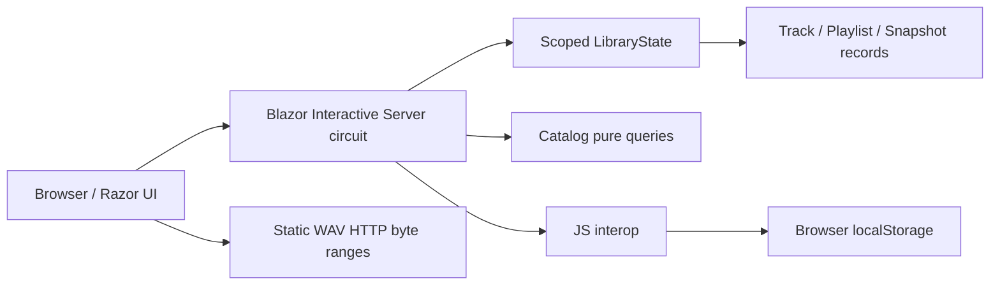

# Architecture and developer notes

## Dependency direction

Core references no web framework. Web depends on Core. ASP.NET Core dependency injection creates a LibraryState per circuit, avoiding shared personal state across visitors. Home coordinates events, so this is a component/state-container architecture rather than an asserted full MVVM implementation. Parameters and EventCallbacks decouple TrackRow from Home. Artwork consumes one Track parameter.

Catalog.Search and Catalog.Mix are pure queries using LINQ. Track is an immutable record. LibraryState deliberately owns mutable collections but exposes defensive copies. Snapshot restore validates version before mutation, caps playlists, deduplicates names and track references, and filters unknown IDs. Browser JSON is untrusted and may be edited by the user. It is never used for authentication or authorization.

The original WAV assets are immutable. ASP.NET Core StaticFileMiddleware supplies range responses and caches them for 24 hours. HTMLAudioElement handles decoding, seeking, buffering and volume. The bridge reports progress at most once per 750 ms. The .NET reference and audio resource are disposed when the component is disposed. There is one audio element per app instance.

## APIs

| Method and path | Query | Response |
| --- | --- | --- |
| GET /health | none | JSON status=ok |
| GET /api/tracks | q optional, genre optional | JSON array of tracks |
| GET /api/mix | mood optional (default Focus) | Ranked tracks without personal favorites |
| GET /audio/{1..6}.wav | Range header optional | audio/wav, 200 or 206 |

The UI uses the injected domain services directly rather than making redundant HTTP calls to its own API. APIs are read-only and expose only public demo metadata. Unknown queries return an empty array. Unknown moods give stable catalog order.

## Persistence

localStorage key: tuneflow.library.v1. JSON schema is represented by LibrarySnapshot: Version, Favorites, Playlists and History. Local storage is origin-specific. Storage failures show a notification and leave session state usable. Corrupt JSON is caught, and the user can continue with a fresh session. No migrations beyond schema version 1 are implemented. State is not synchronized between open tabs.

## Extending and deploying

Add catalog records and corresponding WAV assets together. Introduce a repository interface and a SQL database when adding accounts. Enforce ownership on every mutation. Move audio to licensed object storage/CDN for a large catalog. Server circuits consume memory and need an appropriate SignalR scale-out strategy at multiple instances. Current catalog size is six, so no pagination or performance capacity claim is made. A public deployment also requires persistent encrypted Data Protection keys, HTTPS and supported runtime updates.

## Technology comparison sources

- Microsoft Blazor hosting models: https://learn.microsoft.com/aspnet/core/blazor/hosting-models
- Microsoft Blazor dependency injection: https://learn.microsoft.com/aspnet/core/blazor/fundamentals/dependency-injection
- Microsoft state management: https://learn.microsoft.com/aspnet/core/blazor/state-management/

These sources support the technology discussion. Project behavior is supported by the code and test evidence, not by documentation claims.

## Personal audio import

UploadPanel is a reusable C# Razor component. C# validates title and artist and registers a validated Track with a local audio key. A browser file input passes its selected File directly to the JavaScript adapter, which checks the extension and 20 MB limit, verifies playable audio metadata with a timeout, and writes the File to IndexedDB. No audio upload endpoint is exposed. LibrarySnapshot includes optional Uploads metadata, retaining compatibility with the original schema. LibraryState restores valid uploaded records before validating favorite and playlist references. HTML audio plays an object URL created from IndexedDB and revokes the URL when switching songs or disposing. Imported tracks are private to the browser origin and do not appear in the public demo API.
